<p align="center">
  
</p>

<p align="center">
  
</p>


```
Vim do atendimento ao cliente (SAC e Vendas) e do ensino, e hoje construo carreira em nuvem e cibersegurança. 
Conheço o contact center por dentro, e é agora quero construir (e proteger) o que roda por trás dele.

Certificada AWS (Developer Associate e Cloud Practitioner), 320h de cibersegurança no Hackers do Bem (Blue Team) 
e em formação em Amazon Connect na Escola da Nuvem.

Busco minha primeira oportunidade: Amazon Connect (desenvolvimento ou sustentação) / CloudOps. 
Meu objetivo de longo prazo é Segurança em Nuvem e instrutoria.
```

**EN —** Customer-service background turned cloud developer. AWS Certified Developer – Associate and Cloud Practitioner, Blue Team training (320h), currently learning Amazon Connect. Looking for a first role in Amazon Connect (development or administrator) / CloudOps, with a long-term goal in Cloud Security.


<table>
  <tr>
    <td width="33%"><a href="https://github.com/jessieviana/idosomais"></a></td>
    <td width="33%"><a href="https://github.com/jessieviana/lab-jogo-adivinhacao-aws-serverless"></a></td>
    <td width="33%"><a href="https://github.com/jessieviana/blue-team-lab"></a></td>
  </tr>
</table>

Também em equipe: **Nova Solutions** (arquitetura AWS de controle de consumo por parceiros).

**Em breve:** projeto em equipe da formação em Amazon Connect (Escola da Nuvem), que vou documentar aqui assim que for concluído.


```
┌──────────────────────────────────────┬──────────────────────┐
│ ÁREA                                 │ STATUS               │
├──────────────────────────────────────┼──────────────────────┤
│ AWS Developer Associate (DVA-C02)    │ ✓ CERTIFICADA        │
│ AWS Cloud Practitioner (CLF-C02)     │ ✓ CERTIFICADA        │
│ Amazon Connect · Escola da Nuvem     │ >> EM FORMAÇÃO       │
│ Cibersegurança · Hackers do Bem      │ ✓ CONCLUÍDO          │
└──────────────────────────────────────┴──────────────────────┘
```




```
[INFO] Mentora Técnica voluntária · Escola da Nuvem
[INFO] 83,3% dos alunos acompanhados aprovados no Cloud Practitioner
[INFO] Admin · Gotham Tech Community (comunidade tech liderada por mulheres)
[OK] Building · Learning · Sharing · Repeat
```

<p align="center">
  <a href="https://whatsapp.com/channel/0029VbCdsBj5Ejy0ii0kED3u">
    
  </a>
</p>


[](https://linkedin.com/in/jessieviana)
[](https://www.credly.com/users/jessieviana)

```
[ SESSION ACTIVE · jessieviana@cloud-defender:~$ █ ]
```
